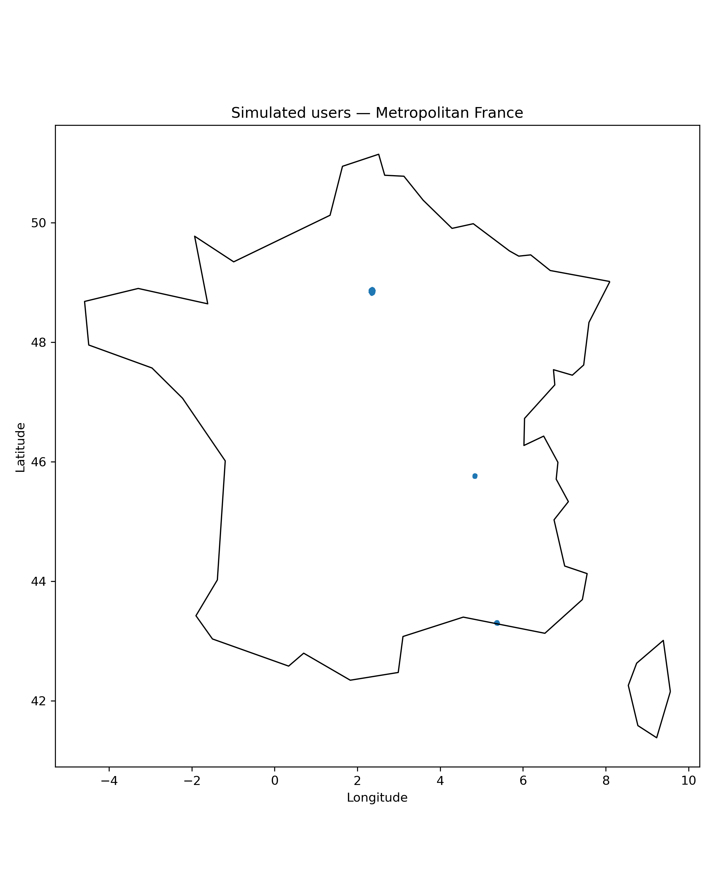

# Kontakt — pipeline ETL et détection de groupes

Projet collectif de traitement de données : extraction d'un CSV de positions simulées, nettoyage, chargement dans PostgreSQL et détection de groupes géographiques avec DBSCAN.

**Auteurs :** Ali Houssenaly, François Gérard, Baptiste Dusollier et Edouard Sechet.

## Parcourir le projet

- [Rapport](docs/report.pdf) · [Présentation business](docs/business_presentation.pdf) · [Exemple de dashboard](docs/dashboard.png)
- [Pipeline principal](main.py) · [Détection des groupes](notif_meeting.py)
- [Génération des données simulées](data/simulate_and_visualize_france_users.py)



L'image est un livrable présent dans le dépôt, pas le résultat d'une nouvelle exécution.

## Fonctionnement

1. Lecture de `data/simulated_users_france.csv`.
2. Nettoyage des coordonnées et des timestamps ; conservation des observations dont l'heure est 18.
3. Chargement du DataFrame dans la table PostgreSQL `users`.
4. Requêtes exploratoires sur Paris, Lyon et Marseille.
5. Détection DBSCAN avec distance haversine, puis export CSV et carte.

Dans `main.py`, l'exemple utilise un rayon de voisinage de 150 mètres, au moins 5 observations et le timestamp `2025-10-08 18:00:00+02:00`. Le rayon DBSCAN définit un voisinage local, pas le diamètre maximal d'un groupe.

## Organisation

| Chemin | Contenu |
|---|---|
| `main.py` | Point d'entrée du pipeline |
| `src/extract_data.py` | Lecture du CSV |
| `src/transform_data.py` | Nettoyage des observations |
| `src/load_data.py` | Connexion, chargement et requêtes PostgreSQL |
| `notif_meeting.py` | Détection de groupes et export ; pas d'envoi de notification implémenté |
| `data/` | Données simulées, génération et visualisation |
| `output/` | CSV et image produits par le pipeline |
| `docs/` | Rapport, présentation et dashboard |
| `database_setup.sql` | Script SQL historique de création de table |

## Environnement et lancement

Le dépôt ne fournit pas encore d'environnement verrouillé. Les dépendances identifiées dans les imports sont Python, pandas, NumPy, SQLAlchemy, scikit-learn, GeoPandas, Shapely et Matplotlib ; la connexion PostgreSQL nécessite également un pilote compatible (psycopg2 pour l'URL actuelle).

Le script de cartographie utilise `gpd.datasets.get_path('naturalearth_lowres')`. Vérifier la disponibilité de cette API dans l'environnement choisi ; la cartographie doit être adaptée si elle n'y existe plus.

1. Préparer un environnement Python isolé avec ces dépendances et une instance PostgreSQL de démonstration.
2. Créer une base `kontakt_db` dédiée. Dans cette version, la connexion est définie par `DATABASE_CONFIG` dans `src/load_data.py` ; elle ne lit pas encore de variables d'environnement. Ne pas publier d'identifiants locaux.
3. Vérifier la présence du CSV fourni et du dossier `output/`.
4. Depuis la **racine du dépôt**, lancer :

```bash
python main.py
```

**Attention :** le chargement utilise `if_exists='replace'` et remplace la table `users`. Le script SQL historique contient aussi `DROP TABLE IF EXISTS users`. Utiliser uniquement une base de démonstration sans données à conserver.

Sorties prévues :

- statistiques et groupes affichés dans le terminal ;
- `output/detected_clusters.csv` ;
- `output/cluster_visualization.png`.

Pour régénérer les données avec le script fourni, exécuter depuis `data/` :

```bash
python simulate_and_visualize_france_users.py simulate
python simulate_and_visualize_france_users.py visualize
```

## Limites et suite du projet

- Prototype académique sur données simulées, sans validation d'exploitation en production.
- Configuration de connexion à externaliser avant réutilisation ; ne pas réutiliser les valeurs de démonstration comme identifiants réels.
- Versions des dépendances et procédure d'installation à figer après test dans un environnement neuf.
- Gestion des cas sans données ou sans groupes à renforcer avant de généraliser l'exemple.
- Les commandes ci-dessus correspondent aux fichiers inspectés ; cette révision documentaire n'exécute pas le pipeline ni ne vérifie de nouvelles performances.
